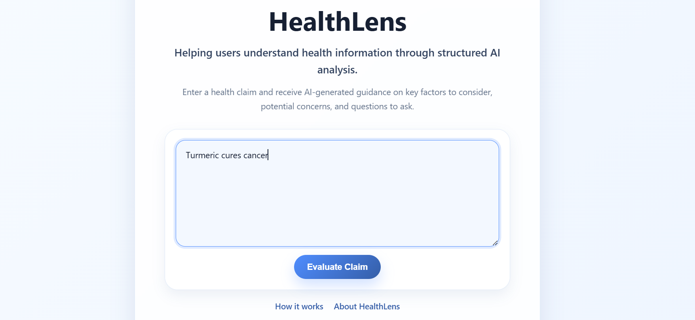
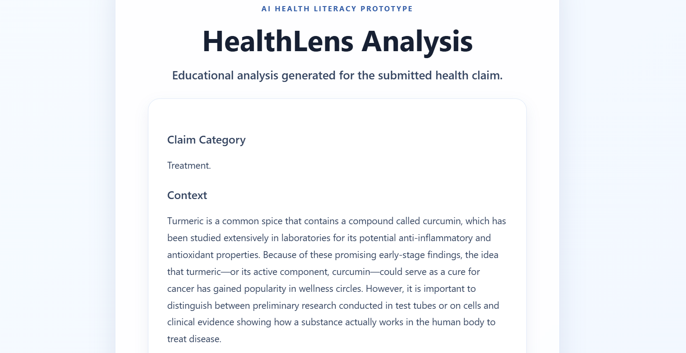
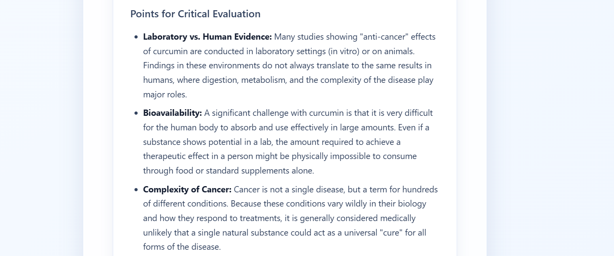
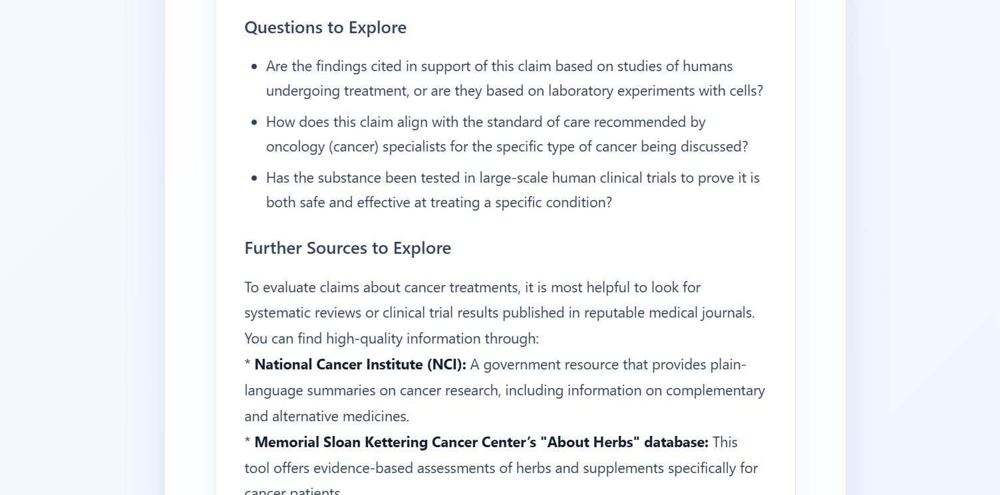

# Project name: HealthLens

HealthLens is an AI-assisted health literacy prototype that helps users examine health-related claims and understand the context behind them. Rather than giving a simple true-or-false verdict, it generates structured explanations to encourage critical thinking.

## My Role and Development Approach

My background in microbiology influenced the health-information aspect of this project. I wanted to create an educational tool that encourages users to examine health claims rather than simply accept or reject them.

My primary contributions included:

- **Problem Framing:** Identified the need for an educational approach to evaluating health claims beyond simple true-or-false classifications.
- **Prompt Design and Refinement:** Used my life-sciences background to guide the development and refinement of the prompt framework. Reviewed generated responses and suggested changes to improve scientific context, relevance and clarity, while avoiding unnecessary uncertainty or oversimplification.
- **Output Evaluation:** Reviewed responses to ensure they provided useful context, encouraged further exploration and did not present AI-generated analysis as scientific verification.
- **Prototype Direction:** Defined the intended functionality and response structure, using AI-assisted coding tools to support implementation and integration.

The application code was developed with AI assistance. This project is not presented as independent software development or advanced Python programming experience.

## Features

- **Health Claim Analysis:** Accepts health-related claims and generates AI-assisted explanations.
- **Structured Results:** Organises responses into claim category, context, points to consider, questions for further exploration and suggested sources.
- **Accessible Explanations:** Presents information in a format intended for a general audience.
- **Informational Pages:** Includes sections describing the project and how it works.
- **Basic Error Handling:** Handles empty inputs, missing API configuration and unsuccessful API requests.

## Screenshots

### Home Page



### Analysis Results

Claim Category and Context



Critical Evaluation



Questions and Further Sources




## Technology Stack

- **Language:** Python
- **Web Framework:** Flask
- **Frontend:** HTML, CSS
- **AI Integration:** Google Gemini API (`google-genai`)
- **Supporting Libraries:** Python-Markdown, Bleach, python-dotenv

## Project Structure

```text
HealthLens/
│
├── app.py
├── requirements.txt
├── .env.example
├── .gitignore
│
├── templates/
│   ├── index.html
│   ├── result.html
│   ├── about.html
│   └── how_it_works.html
│
└── static/
    └── style.css
```

## Installation and Setup

### 1. Clone the repository

```text
git clone YOUR_GITHUB_REPOSITORY_URL
cd HealthLens
```

### 2. Install dependencies

```text
py -m pip install -r requirements.txt
```

### 3. Configure environment variables

Create your own `.env` file in the project's root directory, alongside `app.py`.

Add the following variable:

```text
GEMINI_API_KEY=your_api_key_here
```

Replace the placeholder with your own Gemini API key, available through [Google AI Studio](https://aistudio.google.com/).

**Important:** Do not upload your actual `.env` file or share your API key publicly. The repository includes an `.env.example` file showing the required configuration format.

### 4. Run the application

```text
py app.py
```

Open the application in your browser:

```text
http://127.0.0.1:5000/
```

## Limitations

- Responses are AI-generated and may contain inaccuracies or incomplete explanations.
- The application does not independently verify claims against scientific publications or trusted medical databases.
- Output quality depends on the AI model and the instructions provided.
- HealthLens is an educational prototype, not a diagnostic tool or substitute for professional medical advice.

## Future Scope

Future improvements could include integration with reliable scientific and medical information sources to support generated explanations with relevant research and references, along with further enhancements to functionality and usability.

## Disclaimer

HealthLens is intended for educational and informational purposes only. It does not provide medical advice, diagnosis or treatment recommendations. Users should consult qualified healthcare professionals for medical concerns.